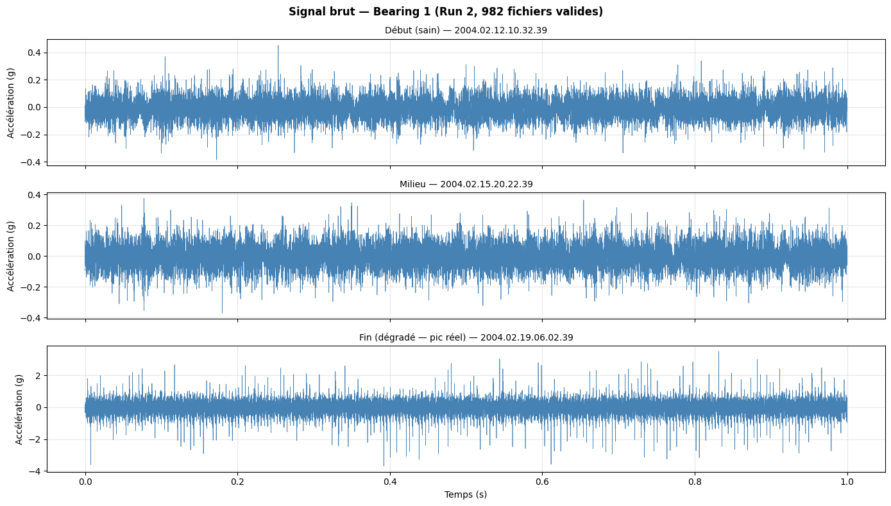
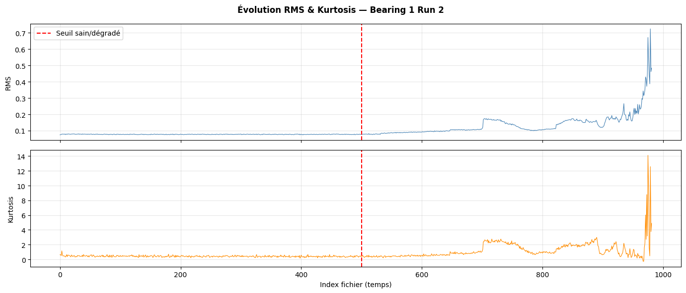
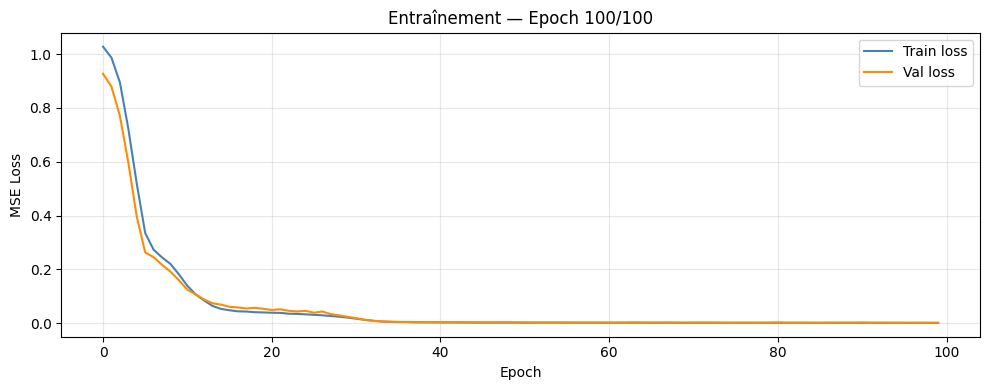
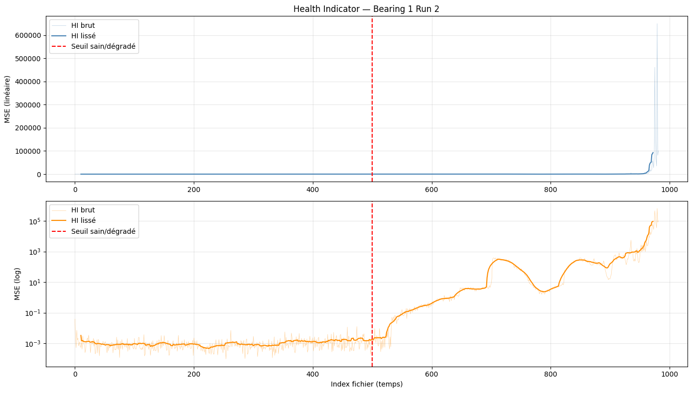
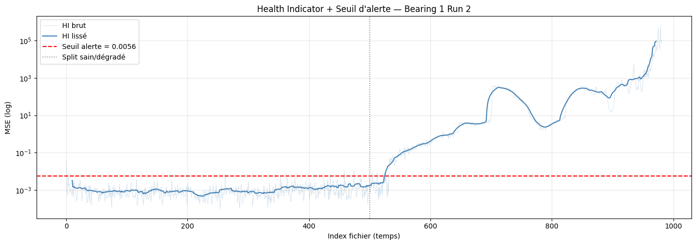
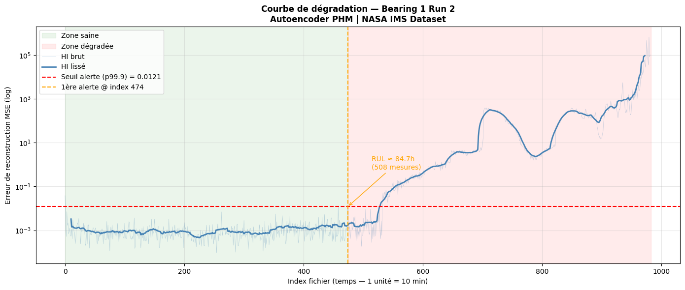
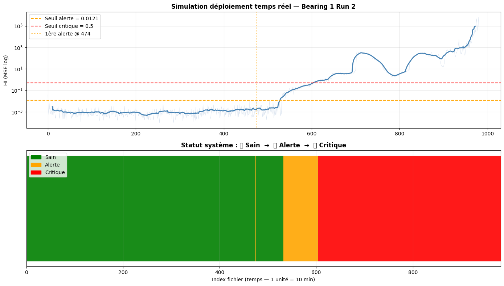

# ⚙️ Predictive Maintenance — Industrial Bearing Degradation Detection

### Unsupervised Deep Learning for Industrial Condition Monitoring

**Author:** Leroy Makita Loubaki  
**Project Type:** Predictive Maintenance & Artificial Intelligence  
**Program:** ESIGELEC — DARIA Engineering Program  
**Dataset:** NASA IMS Bearing Dataset — Run 2

---

## 📖 1. Project Overview

This project explores the use of **unsupervised deep learning for industrial predictive maintenance**, focusing on early degradation detection in rolling-element bearings.

The system analyzes vibration signals and detects deviations from normal operating conditions using an **Autoencoder neural network**.

Unlike supervised fault classification, the model is trained exclusively on healthy operating data. Anomalies are identified through an increase in reconstruction error.

The objective is to provide early warning of bearing degradation, supporting condition-based maintenance decisions.

## 🎯 2. Project Objectives

- Analyze industrial bearing vibration signals.
- Extract relevant time-domain and frequency-domain features.
- Train an Autoencoder using healthy operating data.
- Develop a reconstruction-error-based Health Indicator.
- Detect abnormal behavior using a statistical alarm threshold.
- Evaluate early warning performance on a run-to-failure dataset.

## 🛠️ 3. Technologies and Methods

| Category | Technology / Method |
|---|---|
| Programming | Python |
| Deep Learning | Autoencoder Neural Network |
| Learning Approach | Unsupervised Anomaly Detection |
| Data Processing | Vibration Signal Analysis |
| Feature Scaling | StandardScaler |
| Feature Extraction | Time and Frequency Domain |
| Health Indicator | Mean Squared Reconstruction Error |
| Dataset | NASA IMS Bearing — Run 2 |

## 📊 4. Dataset — NASA IMS Bearing

The project uses the NASA IMS Bearing Dataset, which contains vibration measurements recorded during accelerated bearing degradation experiments.

The selected experiment is **Run 2 — Bearing 1**, associated with an outer race failure.

### Dataset Characteristics

| Parameter | Value |
|---|---|
| Experiment | Run 2 |
| Bearing | Bearing 1 |
| Operating Speed | 2,000 RPM |
| Radial Load | 6,000 lbs |
| Sampling Frequency | 20 kHz |
| Samples per Recording | 20,480 |
| Recording Interval | Approximately 10 minutes |
| Valid Recordings Used | 982 |

The last two recordings were excluded according to the data-quality criteria described in the technical report.

## 🔬 5. Feature Engineering

Eight statistical features were extracted from each vibration recording.

| Feature | Purpose |
|---|---|
| RMS | Signal energy |
| Variance | Signal dispersion |
| Kurtosis | Impulsiveness |
| Skewness | Distribution asymmetry |
| Peak | Maximum absolute amplitude |
| Crest Factor | Peak-to-RMS ratio |
| FFT Mean | Average frequency spectrum magnitude |
| FFT Standard Deviation | Frequency spectrum dispersion |

These features provide a compact representation of bearing vibration behavior.

## 🧠 6. Autoencoder Architecture

The model learns to reconstruct feature vectors representing healthy bearing behavior.

### Neural Network Architecture

**Input (8) → Dense (64) → Dense (32) → Latent Space (16) → Dense (32) → Dense (64) → Output (8)**

The encoder and decoder use fully connected layers.

### Training Configuration

| Parameter | Value |
|---|---|
| Training Samples | 350 healthy recordings |
| Validation Samples | 150 healthy recordings |
| Optimizer | Adam |
| Learning Rate | 0.001 |
| Loss Function | Mean Squared Error |
| Early Stopping | Patience = 10 |
| Final Validation Loss | 0.001374 |

The feature scaler was fitted using healthy data only.

## 📈 7. Health Indicator

The system uses reconstruction error as a Health Indicator (HI).

For each vibration recording, the Autoencoder reconstructs the input feature vector.

The mean squared error between the original and reconstructed vectors measures deviation from the learned healthy operating condition.

A higher reconstruction error indicates behavior increasingly different from the training distribution.

## 🚨 8. Degradation Detection

An alarm threshold was defined using the **99.9th percentile** of reconstruction errors from healthy recordings.

The reported threshold is:

**0.012051**

### Experimental Results

| Indicator | Reported Result |
|---|---:|
| Evaluated Recordings | 982 |
| First Alarm | Recording Index 474 |
| False Alarms in the Reported Nominal Phase | 0 / 474 |
| Reported Warning Lead Time | 84.7 hours |

The report estimates a warning lead time of approximately **84.7 hours before the final bearing failure**.

These results concern the selected NASA IMS Run 2 experiment. They should not be interpreted as validated performance across different industrial machines.

## 📉 9. Visualization and Monitoring

The notebook includes visualizations of:

- Raw vibration signals
- RMS and kurtosis trends
- Autoencoder training loss
- Health Indicator evolution
- Preliminary alarm threshold analysis
- Final bearing degradation curve
- Simulated industrial condition monitoring

These visualizations illustrate the progression from nominal operation to degradation.
### 📊 Experimental Visualizations

#### Raw Vibration Signals

#### RMS and Kurtosis Trends

#### Autoencoder Training Loss

#### Health Indicator Evolution

#### Preliminary Alarm Threshold

*This figure shows an intermediate threshold experiment, not the final reported alarm configuration.*

#### Final Degradation Curve

#### Industrial Monitoring Simulation

*The monitoring visualization is a simulation based on the NASA IMS dataset, not a validated live industrial deployment.*

## ⚠️ 10. Limitations

- The main evaluation is based on a single run-to-failure experiment.
- Generalization to other bearing operating conditions has not been established.
- The system provides anomaly alarms rather than remaining useful life predictions.
- Reconstruction error may fluctuate during degradation.
- Additional threshold calibration and independent validation are required before industrial deployment.

## 🚀 11. Future Improvements

- Incorporate bearing-specific fault frequencies such as BPFO and BPFI.
- Implement multi-level health warnings.
- Add alarm hysteresis to reduce sensitivity to isolated peaks.
- Evaluate performance across multiple machines and operating conditions.
- Develop a real-time operator dashboard.
- Explore edge deployment and integration with industrial maintenance systems.

## 👨‍💻 12. Author

**Leroy Makita Loubaki**

Engineering Student — ESIGELEC, DARIA  
Engineering Apprentice — Constellium

Interested in Industrial AI, Predictive Maintenance, Robotics, Automation and Intelligent Systems.

## 🌐 Connect With Me

[LinkedIn](https://www.linkedin.com/in/leroy-makita-loubaki-a78792290/) · [TikTok](https://www.tiktok.com/@kingtronix5) · [YouTube](https://youtube.com/@leroymakitaloubaki)

---

*Personal technical project — June 2026.*
